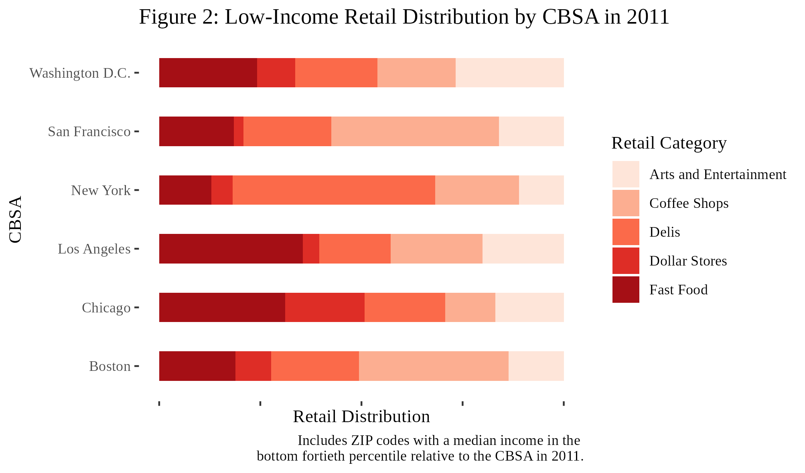
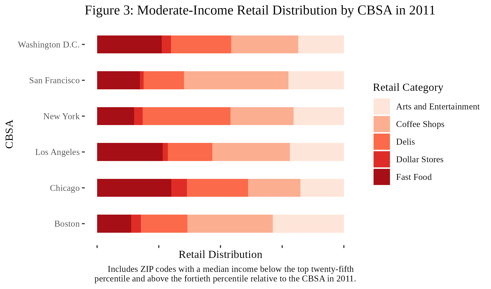
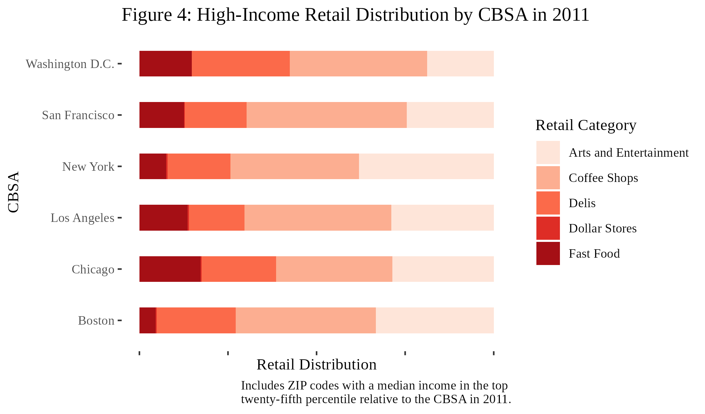

<!-- =============================================== -->
<!-- Program: 03_checkpoint.Rmd -->
<!-- Author: Jameson Roth -->
<!-- Date: 2026 11 16 -->
<!-- Description: Collect visualizations and explain data pipeline so far for purposes of documentation -->
<!-- =============================================== -->

```{r}
library(tidyverse)
library(rprojroot)
```

# 1: Data Pipeline

There are three data sources that make up the final, joined dataset: ZHVI data,
income data, and retail data. Each source is available at the zipcode-year
level. The retail data uses ZCTAs, which are slightly different from ZIP codes.
To accomodate this, a crosswalk file was used to match ZIP codes to ZCTAs. The
data cleaning pipeline comprises four steps:

## 1. Geographic data collection

We start with an Excel delineation file from the Census Bureau that provides,
for all US counties, the CBSA the county belongs to, and whether that county is
central or outlying. This dataset is cleaned to provide only the relevant
columns for the six CBSAs that this project is concerned with, giving us a list
of all counties for each CBSA, and whether that county is central or outlying.

Then, a call is made to the HUD User API to download all of the county-zip
crosswalk files for each county in the aforementioned dataset. These files
provide a list of all ZIP codes belonging to each county. All of the county-zip
files are then merged with the county-CBSA file mentioned above. This gives a
dataset with the following columns: CBSA code, county code, Central/Outlying,
and ZIP code. This dataset is then merged with a ZIP code-ZCTA crosswalk file.
There are three zip codes that have no associated ZCTA, and these three are
dropped from the dataset. Thus concludes the collection of geographic data, and
we are left with a dataset that has, for all ZIP codes in all six CBSAs: ZIP
code, ZCTA, county code, Central/Outlying, and CBSA code.

```{r}
setwd(find_root(is_git_root))
geo <- read_csv("0_data/1_clean/county_zip.csv")
summary(geo)
```

## 2. SOI data merge

Next, the income data was collected for the years 2011 to 2022 from the IRS
website, and merged into one dataset. This dataset had the following columns:
ZIP code, year, AGI stub, number of returns, and total AGI. This dataset had
one row for each ZIP code-AGI stub-year.

This dataset was then merged with the geographic dataset, so that each ZIP
code's information could be associated with its CBSA. The median income was
then computed for each ZIP code-year. Because the SOI uses a binned measurement
of income, the R package binsmooth was used to determine the distribution of
income for each CBSA-year. This distribution was then used to give each ZIP
code's median income a percentile ranking based on the distribution for that
CBSA in that year. The resulting dataframe has one row for each ZIP code-year,
and the following columns: ZIP code, year, CBSA code, ZIP code median income,
Central/Outlying, and ZIP code percentile rank.

```{r}
setwd(find_root(is_git_root))
soi <- read_csv("0_data/1_clean/soi_fitted.csv")
summary(soi)
```

## 3. ZHVI data merge

The original ZHVI data from Zillow has the following columns: ZIP code, date of
observation, and ZHVI. The ZHVI is provided an a monthly basis, so the annual
average was computed for each ZIP code. Then, this data was merged with the
geographic data, and the percentile rank of each ZIP code-year's ZHVI was
computed in relation to the relevant CBSA-year's ZHVI distribution. The resulting
dataset has the following columns: ZIP code, year, and ZHVI ranking.

```{r}
setwd(find_root(is_git_root))
zhvi <- read_csv("0_data/1_clean/zhvi.csv")
summary(zhvi)
```

## 4. Retail data merge

The retail data is provided by NaNDA on the ZCTA-year level, with one file for
each retail category. Each of the retail counts files was first merged with the
geographic dataset in order to match each ZCTA to a ZIP code. This process
results in one dataframe for each retail category, with measurements of the
retail counts for each ZCTA-year. All of these files were then merged and
pivoted into long format, which gives a dataset with one row per ZIP code-year,
with the following columns: ZIP code, ZCTA, year, CBSA code, category of
business, and the count of businesses in that category.

```{r}
setwd(find_root(is_git_root))
retail <- read_csv("0_data/1_clean/retail_counts.csv")
summary(retail)
```

# Data Visualizations

The following charts showing the retail distribution for low-, high-, and
moderate-income ZIP codes in 2011 show a potential pattern of retail change.
Higher-income ZIP codes have fewer fast-food restaurants and dollar stores, and
lower-income ZIP codes have fewer coffee shops.






